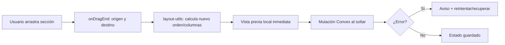

BuilderCV: arquitectura del editor híbrido
Para BuilderCV, elegiría un editor híbrido que permita personalizar el diseño del currículum y reorganizar sus secciones sin convertir la página en un lienzo completamente libre. La idea es combinar la comodidad de un editor visual con la precisión que necesita un documento A4 que después se exportará a PDF.
Mi recomendación es utilizar dnd-kit para ordenar y mover secciones, mantener la distribución mediante diseños predefinidos y reutilizar el mismo sistema de presentación para la vista previa y el PDF. No incorporaría react-grid-layout en la primera versión.
1. Cómo debería funcionar el editor

1. Panel de edición
Contenido y estructura
El usuario edita sus datos, añade o elimina secciones, reordena experiencia y formación, y decide qué secciones van en cada columna.

2. Vista previa A4
Resultado visual realista
El currículum se actualiza mientras se edita. La vista previa debe respetar las proporciones, tipografía, márgenes y saltos de página del documento final.

3. Personalización visual
Diseño controlado
Colores, fuentes, tamaño del texto, márgenes, separación entre bloques, plantilla y estructura de una o dos columnas.

El usuario debe poder arrastrar una sección de «Experiencia» por encima de «Formación», por ejemplo, o trasladarla a otra columna. Pero no debería poder colocarla accidentalmente en cualquier coordenada de la página ni redimensionarla de una forma que rompa el PDF.
2. Arquitectura de componentes
Separaría el editor en cuatro áreas funcionales y una capa compartida de presentación.

BuilderCVEditor
├── EditorToolbar
│   ├── UndoRedo
│   ├── LayoutSelector
│   ├── ZoomControls
│   └── ExportPDFButton
├── EditorWorkspace
│   ├── ContentSidebar
│   │   ├── PersonalInfoForm
│   │   ├── SectionList          ← dnd-kit
│   │   └── SectionEditor
│   ├── DesignSidebar
│   │   ├── TemplateSelector
│   │   ├── TypographyControls
│   │   ├── ColorControls
│   │   └── SpacingControls
│   └── ResumePreview
│       └── ResumeDocument
│           ├── ResumeHeader
│           ├── ResumeColumn
│           └── ResumeSection
└── SharedRendering
    ├── ResumeDocument
    ├── PrintStyles
    └── PDFRenderer

ResumeDocument sería la pieza central: recibe los datos y la configuración visual y construye el documento. No debería contener lógica de guardado, formularios ni operaciones de arrastre.
La vista previa y la exportación deben compartir ese componente o, como mínimo, compartir exactamente las mismas reglas de composición y estilos. Es la decisión arquitectónica más importante de esta propuesta.
3. Cómo integraría dnd-kit
Utilizaría dnd-kit exclusivamente para la interacción de arrastrar y soltar. La distribución final del documento la controlaría BuilderCV.
Qué permitiría arrastrar
Elemento	Comportamiento
Secciones	Reordenar mediante una zona de agarre
Secciones entre columnas	Mover de la columna principal a la lateral y viceversa
Elementos dentro de una sección	Opcional: reordenar empleos, estudios o proyectos
Columnas	Cambiar entre diseños predefinidos
Bloques libres	No permitir posicionamiento arbitrario en esta fase
Por ejemplo, el usuario podría mover «Habilidades» desde la columna lateral a la principal. La operación modificaría la configuración del documento, no las coordenadas de un elemento en pantalla.
Modelo de datos para la distribución
Mantendría separadas tres cosas: contenido, diseño visual y distribución.
type ResumeLayout = {
  templateId: string;
  columns: {
    main: string[];
    sidebar: string[];
  };
};

type ResumeDesign = {
  accentColor: string;
  fontFamily: string;
  fontSize: number;
  pageMargin: number;
  sectionSpacing: number;
};

En este ejemplo, las cadenas de main y sidebar serían identificadores estables de secciones, no sus nombres visibles. Así, cambiar el idioma o el título de una sección no alteraría su identidad.
El contenido —experiencia, formación, habilidades, etc.— seguiría en su estructura actual. No lo duplicaría dentro de ResumeLayout.
Flujo de una operación de arrastre

> Nota (2026-10-11): el arrastre con dnd-kit queda diferido a la fase F2
> del roadmap (`docs/roadmap-futuro.md`). Hasta entonces, el reorden se hace
> con los botones subir/bajar y la distribución con el selector de
> una/dos columnas.

La implementación debería seguir estas reglas:
- IDs estables: cada sección debe tener un identificador persistente.
- Guardado al soltar: no guardar en Convex cada movimiento del puntero.
- Arrastre accesible: ofrecer controles de teclado y una alternativa al arrastre, por ejemplo, acciones para subir, bajar o cambiar de columna.
- Validación de destinos: impedir secciones duplicadas o destinos incompatibles con la plantilla.
- Estado local inmediato: actualizar la vista previa antes de esperar la respuesta del servidor.
- Sin conflictos: si falla el guardado, informar al usuario y permitir recuperar o reintentar el cambio.
Usaría la API actual de dnd-kit, comprobando la versión que instaléis. Hay ejemplos antiguos que utilizan paquetes y APIs anteriores; mezclar ambas generaciones puede complicar innecesariamente la implementación.
4. Cómo mantener el PDF consistente con la vista previa
Esta es la parte a la que dedicaría más esfuerzo. En BuilderCV, el PDF no puede ser una interpretación aproximada del editor: debe ser el resultado del mismo documento.
La regla principal
Datos del CV + distribución + tema

ResumeDocument
Un único sistema de composición

Vista previa
Escalada para pantalla

Exportación PDF
Medidas de impresión

No crearía una versión del currículum para la vista previa y otra distinta para imprimir. Tampoco intentaría reconstruir el PDF a partir de las posiciones visuales calculadas por dnd-kit.
Medidas y estilos
La página debe tener unas dimensiones de impresión definidas, independientemente del tamaño de la ventana del navegador.
Aspecto	Recomendación
Papel	A4: 210 × 297 mm
Márgenes	Definidos por la plantilla o por el usuario, dentro de límites razonables
Escalado de pantalla	Aplicarlo al contenedor de la vista previa, no al documento exportado
Tipografías	Cargar y esperar a que estén listas antes de generar el PDF
Imágenes	Esperar a que carguen y reservar su espacio
Colores	Usar las mismas variables CSS en vista previa e impresión
Paginación	Definir reglas de salto de página y probarlas con contenido largo
Si actualmente BuilderCV genera el PDF mediante Playwright y Chromium, conservaría ese enfoque mientras funcione bien. Permite utilizar el mismo HTML y CSS que el navegador y evitar mantener un segundo motor de renderizado.
Hay una distinción importante: compartir el componente no garantiza por sí solo una identidad perfecta. Las fuentes, la configuración de impresión y los saltos de página pueden cambiar el resultado. Por eso, la exportación debe esperar a que las fuentes y las imágenes estén cargadas y utilizar unas reglas de impresión explícitas.
Paginación: no dejarla para el final
Probaría desde el principio estos casos:
- Un CV de una sola página.
- Un CV de dos o tres páginas.
- Una experiencia laboral con una descripción muy larga.
- Una sección que empieza al final de una página.
- Una columna lateral más larga que la principal.
- Un CV sin fotografía o sin algunos datos opcionales.
- Textos largos, caracteres especiales y distintas fuentes.
CSS permite controlar muchos saltos mediante break-before, break-after y break-inside. Por ejemplo, break-inside: avoid puede evitar que una entrada laboral se divida entre páginas, aunque no puede impedirlo siempre si el bloque es más alto que una página completa.
Evitaría fijar alturas rígidas a las secciones. Un diseño que parece correcto con datos de ejemplo puede desbordarse cuando el usuario introduce su propia experiencia.
5. Persistencia en Convex y guardado automático
No guardaría todo el documento cada vez que se cambia un color o se mueve una sección. Mantendría un único documento de CV, con sus distintas áreas de configuración.
Una estructura conceptual podría ser:
type ResumeDocumentData = {
  content: ResumeContent;
  layout: ResumeLayout;
  design: ResumeDesign;
};

Es una propuesta de organización, no una indicación para reemplazar directamente los tipos actuales de BuilderCV.
En Convex, mantendría las mutaciones y validaciones en el servidor. Cada operación debería comprobar que el CV pertenece al usuario autenticado y que la nueva configuración es válida.
Para el autoguardado:
1. El cambio se aplica inmediatamente en el estado local.
2. Se agrupan cambios próximos mediante un pequeño retardo de guardado.
3. Se envía la actualización a Convex.
4. La interfaz indica si hay cambios pendientes, si se están guardando o si se ha producido un error.
5. Al cambiar de CV o abandonar el editor, se evita perder los cambios pendientes.
Conviene evitar que una respuesta antigua del servidor sobrescriba cambios locales más recientes. Si BuilderCV ya tiene un sistema de autoguardado fiable, lo reutilizaría en lugar de crear otro.
6. Organización del código
Adaptaría esta estructura a las convenciones y carpetas que ya tenga el repositorio, sin hacer una reorganización masiva:
components/resume-editor/
├── editor-shell.tsx
├── editor-toolbar.tsx
├── content-sidebar.tsx
├── design-sidebar.tsx
├── layout-selector.tsx
├── section-sortable-list.tsx
├── section-drop-zone.tsx
├── resume-preview.tsx
└── resume-document.tsx

lib/resume/
├── layout-schema.ts
├── design-schema.ts
├── layout-utils.ts
├── print-styles.ts
└── validation.ts

Las responsabilidades quedarían así:
- section-sortable-list.tsx: interacción con dnd-kit.
- layout-utils.ts: funciones puras para mover secciones entre columnas, validar IDs y calcular el nuevo orden.
- resume-document.tsx: composición visual compartida.
- print-styles.ts: reglas de impresión y paginación.
- validation.ts: validación de la configuración tanto en el cliente como en el servidor, adaptada a los validadores que ya utilice Convex.
No añadiría un nuevo gestor de estado global sin una necesidad real. Si el editor ya tiene un sistema de estado funcional, lo ampliaría.
7. Plan de implementación por fases

Fase 1. Consolidar el renderizador
Prioridad alta
Separar o consolidar la composición del documento, la configuración de diseño y las reglas de impresión. Antes de añadir interacciones, verificar que el PDF ya reproduce correctamente los datos y la plantilla.

Fase 2. Personalización visual
Implementar colores, tipografías, márgenes y espaciado, junto con una selección de estructuras predefinidas de una o dos columnas. Todo debe persistir al volver a abrir el CV.

Fase 3. Integrar dnd-kit
Añadir ordenación de secciones y movimiento entre columnas. Probar primero con dos o tres secciones y después con todas las plantillas compatibles.

Fase 4. Validación de PDF
Automatizar exportaciones con Chromium y comparar resultados visuales con referencias conocidas. Probar varias longitudes de contenido, tamaños de fuente y configuraciones.

8. Criterios para considerar terminado el editor
- [ ] Las modificaciones visuales se guardan y sobreviven a una recarga.
- [ ] Se pueden ordenar secciones y trasladarlas entre columnas.
- [ ] La operación funciona con ratón y teclado.
- [ ] No aparecen secciones duplicadas ni se pierden datos al cambiar de plantilla.
- [ ] La vista previa y el PDF utilizan la misma configuración.
- [ ] Las tipografías, los colores y los márgenes se mantienen en la exportación.
- [ ] Los CV extensos no cortan contenido ni generan páginas vacías inesperadas.
- [ ] Los errores de guardado se comunican y no provocan pérdida silenciosa de cambios.
Mi decisión técnica: empezaría por el renderizador compartido y el modelo de distribución; después incorporaría dnd-kit. No introduciría react-grid-layout salvo que, tras probar el editor, se vea que los usuarios necesitan mover y redimensionar bloques arbitrariamente.
Hay una ventaja importante en este enfoque: BuilderCV puede evolucionar más adelante hacia una personalización mucho más avanzada sin tener que rehacer el sistema de contenido ni el de exportación.